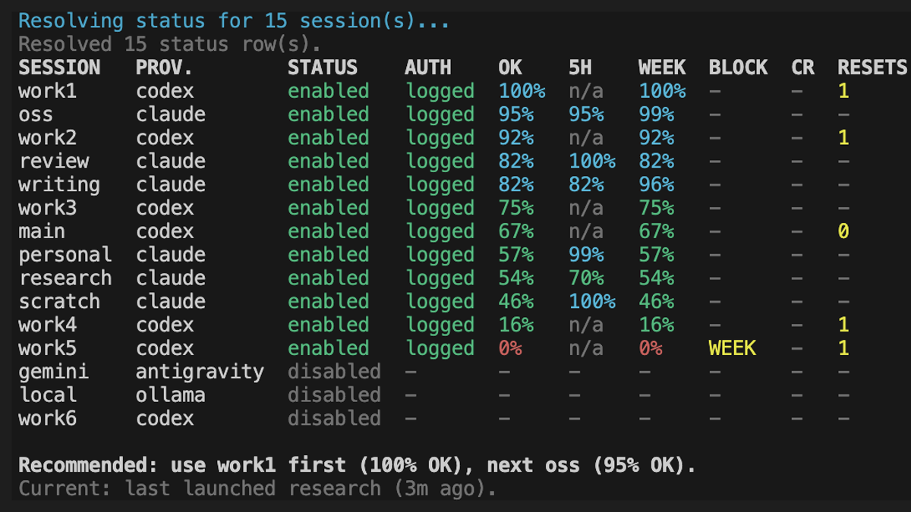
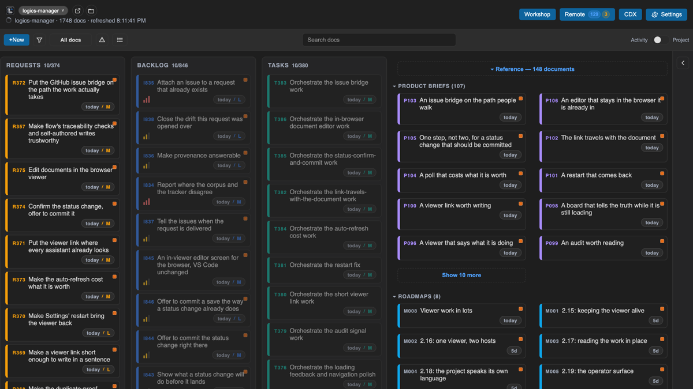
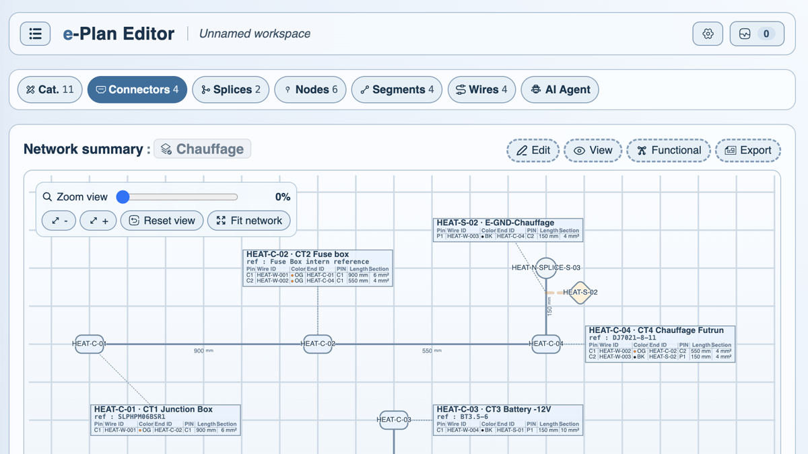
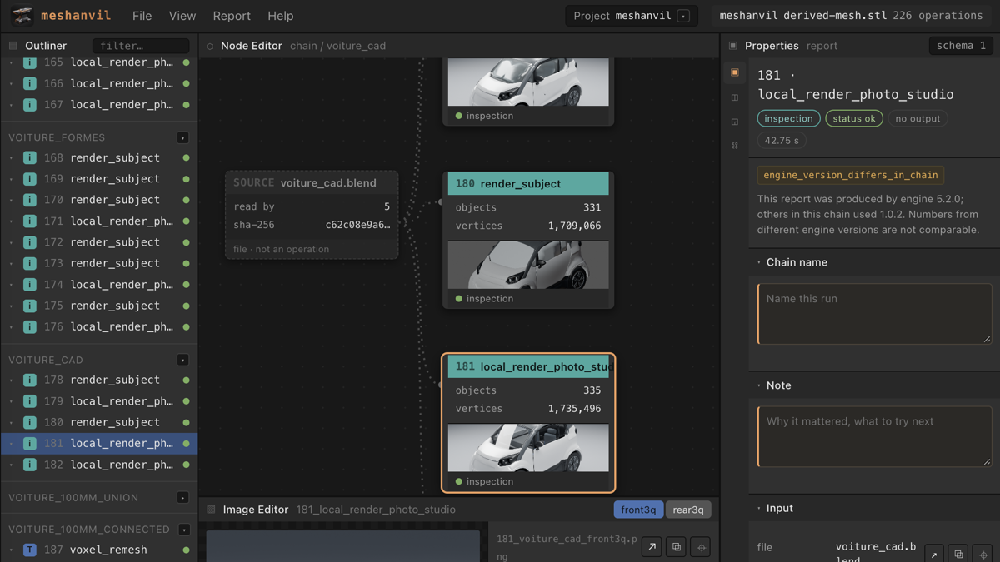
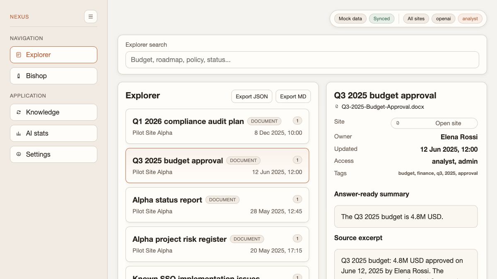
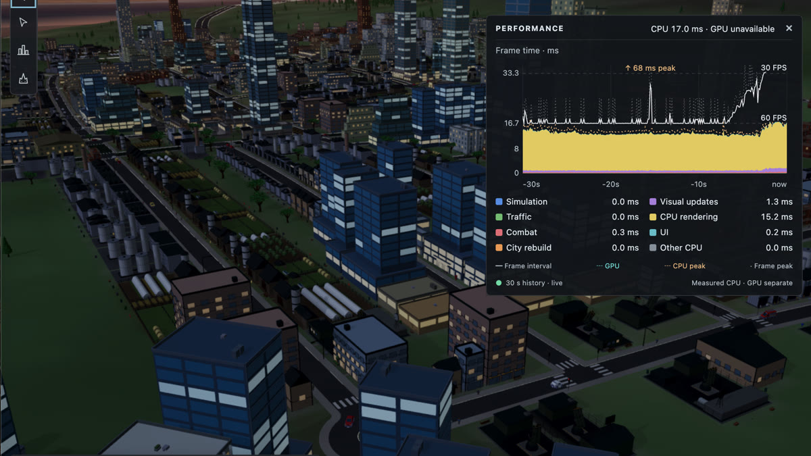
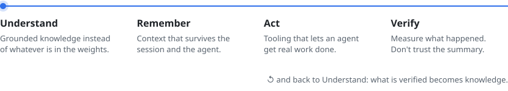

I build the tools around AI agents: what they understand, what they remember, what they do, and what they can prove.

<a href="https://github.com/AlexAgo83?tab=repositories"><picture><source media="(prefers-color-scheme: dark)" srcset="assets/projects-dark.svg"></picture></a>

## Projects

<table>
<tr>
<td width="50%" valign="top">
 
 <b><a href="https://github.com/AlexAgo83/cdx-manager">cdx-manager</a></b> 
One terminal for every agent account: sessions, quotas and context handoffs.
</td>
<td width="50%" valign="top">
 
 <b><a href="https://github.com/AlexAgo83/logics-manager">logics-manager</a></b> 
Persistent context and traceable workflows, from idea to verified task.
</td>
</tr>
<tr>
<td width="50%" valign="top">
 
 <b><a href="https://github.com/AlexAgo83/electrical-plan-editor">electrical-plan-editor</a></b> 
Design, validate and export electrical plans from a local-first workspace.
</td>
<td width="50%" valign="top">
 
 <b><a href="https://github.com/AlexAgo83/meshanvil">meshanvil</a></b> 
Lets AI operate 3D applications, with evidence of what actually happened.
</td>
</tr>
<tr>
<td width="50%" valign="top">
 
 <b><a href="https://github.com/AlexAgo83/deepvault">deepvault</a></b> 
Governed knowledge sources for AI, with provenance and permissions kept.
</td>
<td width="50%" valign="top">
 
 <b><a href="https://github.com/AlexAgo83/city-jump">city-jump</a></b> 
A browser 3D city builder grown from one playable road graph. Just for fun.
</td>
</tr>
</table>

## How it fits together

<picture><source media="(prefers-color-scheme: dark)" srcset="assets/loop-dark.svg"></picture>

Building the tools that make AI better at building things.

